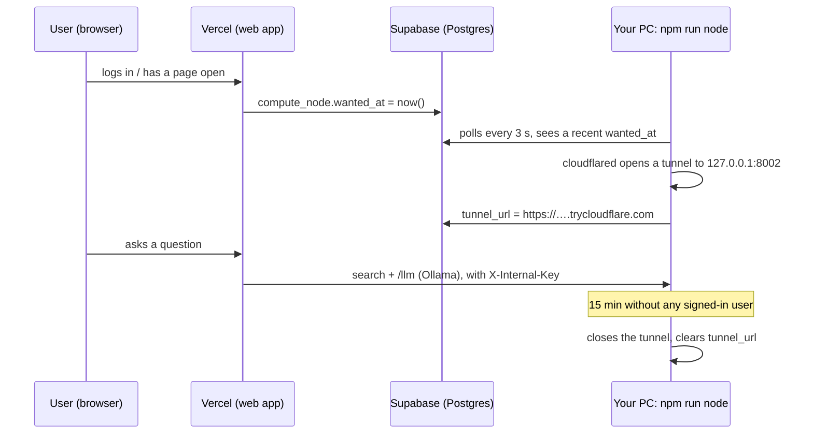

# Free hosted deployment: Vercel + Supabase + your PC

The web app runs on **Vercel** and the data lives in **Supabase**, so login, dashboard, uploads and the document list are always online. The heavy parts run on **your own PC**: the embedding model, spaCy, OCR and **Ollama**. Free hosts cannot run those, because they need several GB of RAM.

The PC is connected **only while someone is using the site**:



- **Waking up** takes about 10–20 seconds after login. The services are already running on the PC, so only the tunnel has to open. Until it is ready, pages show *"Starting the assistant on the host computer…"*.
- **While the PC is off,** login, the dashboard, document lists and uploads still work. Uploads wait in the database and are processed when the PC is back. Chat, search and the knowledge graph return to service once it is on again.
- **Ollama is never exposed.** The tunnel reaches only the intelligence service. Chat goes through its `/llm` proxy, and every endpoint except `/health` requires `INTERNAL_API_KEY`.

Everything below is on free plans. No VM, no Docker and no Cloudflare account are needed.

---

## 1. Supabase (database)

1. Create a project at [supabase.com](https://supabase.com) and choose a region close to you. Save the database password.
2. Open **SQL Editor** and run these files in order (paste each one, then press Run):
   `infrastructure/docker/postgres/init_local.sql`, then `local/002_document_chunks.sql`, `003_local_graph.sql`, `004_document_previews.sql`, `005_alerts_and_orders.sql`, `006_hosted_mode.sql`.
3. **Turn off the Data API** (*Project Settings → Data API*). The app talks to Postgres directly. Leaving the Data API on would publish the tables over REST.
4. Under **Connect**, copy two connection strings:
   - **Transaction pooler** (port **6543**) is for Vercel.
   - **Session pooler** (port **5432**) is for your PC.

## 2. Secrets

Generate two random values and use the **same** values on Vercel and on the PC:

```bash
node -e "console.log(require('crypto').randomBytes(32).toString('hex'))"   # SESSION_SECRET
node -e "console.log(require('crypto').randomBytes(32).toString('hex'))"   # INTERNAL_API_KEY
```

## 3. Vercel (web app)

1. Import the GitHub repo at [vercel.com/new](https://vercel.com/new) and set **Root Directory = `apps/web`**. Vercel detects Next.js and pnpm on its own.
2. Add these environment variables (Production):

   | Name | Value |
   |:--|:--|
   | `DATABASE_URL` | Supabase **transaction pooler** URL (port 6543) |
   | `DATABASE_PREPARE` | `false` |
   | `DATABASE_POOL_MAX` | `3` |
   | `SESSION_SECRET` | from step 2 |
   | `INTERNAL_API_KEY` | from step 2 |
   | `STORAGE_BACKEND` | `db` |
   | `COMPUTE_NODE` | `tunnel` |
   | `LLM_PROVIDER` | `ollama` |
   | `LLM_MODEL` | `llama3` (the model you pulled on the PC) |
   | `LLM_NUM_CTX` | `6144` |

3. Deploy. The site is now at `https://<project>.vercel.app`. Vercel provides HTTPS, which the secure session cookie needs.

## 4. Your PC (compute node)

You need the same setup as local development: Python virtualenvs for `services/ingestion` and `services/intelligence` (running `npm run dev` once creates them), Ollama with your model (`ollama pull llama3`), and **cloudflared**:

```powershell
winget install --id Cloudflare.cloudflared     # Windows; then open a new terminal
```

Add these lines to the root `.env`. Your local `DATABASE_URL` can stay as it is, so `npm run dev` keeps working:

```
NODE_DATABASE_URL=<Supabase session pooler URL, port 5432>
INTERNAL_API_KEY=<same as Vercel>
LLM_PROVIDER=ollama
LLM_MODEL=llama3
```

Start it:

```bash
npm run node
```

It starts the intelligence service on `127.0.0.1:8002` and the ingestion worker. It then waits: the first signed-in user opens the tunnel, and 15 minutes without activity closes it (change this with `TUNNEL_IDLE_MINUTES`). Stop it with Ctrl+C, which also closes the tunnel.

**To start it automatically:** in Windows Task Scheduler, create a task that runs at log on, with program `npm`, arguments `run node`, and *Start in* set to the repo folder.

## 5. Load the demo company (optional)

Seeding goes through the hosted site and needs the PC running so the uploads get indexed:

```powershell
$env:VEDA_BASE_URL="https://<project>.vercel.app"
$env:SEED_DATABASE_URL="<Supabase session pooler URL>"
services/ingestion/.venv/Scripts/python.exe scripts/demo/seed_tenant.py
```

---

## Limits of the free setup

| Limit | Effect |
|:--|:--|
| Vercel request body: **4.5 MB** | Larger uploads are rejected by Vercel before they reach the app. For big files, run the app yourself or split them. |
| Supabase free database: **500 MB** | It holds uploaded files, passages and embeddings. The Nephrova demo fits easily; the multi-GB Enron data does not. |
| Supabase pauses projects after **7 days** without traffic | Open the site or the Supabase dashboard once a week, or restore the project from the dashboard. |
| Quick tunnels have no uptime guarantee, and the address changes on every open | The agent republishes the address each time. For a fixed address, create a named tunnel (free, needs a domain on Cloudflare) and set `TUNNEL_TOKEN` and `TUNNEL_URL`. |
| Login rate limits are kept in memory per Vercel instance | They are weaker than on a single server, and they reset on cold starts. |
| Chat speed depends on your PC | It answers exactly as fast as `npm run dev` does locally. |

## Using a hosted LLM instead of Ollama

If you set `LLM_PROVIDER=openai` on Vercel with a hosted OpenAI-compatible API (for example Groq: `LLM_BASE_URL=https://api.groq.com/openai/v1`, `LLM_MODEL=llama-3.1-8b-instant`, `LLM_API_KEY=…`), answers come from that API directly and do not go through your PC. Search still needs the PC. Retrieved passages are then sent to that provider.
